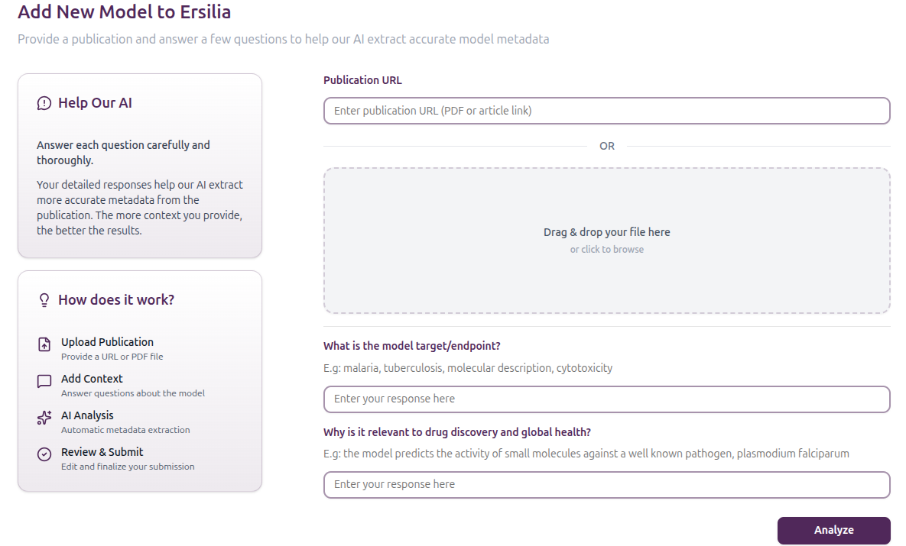

# Model incorporation workflow

## Overview

The model incorporation pipeline is streamlined by a series of GitHub Actions that will automatize model testing and updating of our backend services (Airtable, DockerHub and AWS), simplifying the process for model contributors. The different workflows involved can be found in:

* Reusable workflows: the actual workflows are stored in a single repository, [ersilia-model-workflows](https://github.com/ersilia-os/ersilia-model-workflows), so any change done in those will easily propagate to all models.
* Caller workfflows: the reusable workflows are called by the workflows in [eos-template](https://github.com/ersilia-os/eos-template/tree/main/.github/workflows) upon Pull Request (PR) or Push to the model repository.
* Model request workflow: the model incorporation pipeline is triggered when a Model request issue is approved by an Ersilia maintainer. This [workflow](https://github.com/ersilia-os/ersilia/blob/master/.github/workflows/approve-dispatch.yml) is part of Ersilia's main repository workflows.

More details on the actual workflows can be found in the [Developers](../developer-docs/#ci-cd-workflows-and-testing) section. Here we are just giving an overview of the steps a model contributor needs to take to successfully include a new model in Ersilia.

## A toy example

If you want to test the workflow with a toy example, we have prepared an [Ersilia Demo Repository](https://github.com/ersilia-os/eos-demo). This repository is focused on illustrating the GitHub Actions workflows to be followed in order to successfully incorporate a model to the Ersilia Model Hub.

### 1. Create a model request at Ersilia

You can create a model request through two channels: directly via GitHub, or through the Ersilia Model Request App, a web interface that guides you through the submission process with AI assistance. Both options result in a model request issue being opened in the Ersilia repository for the team to review.

#### 1.1 Using Github

1. Go to the Ersilia main repository [issues page](https://github.com/ersilia-os/ersilia/issues).
2. Click on **New issue**. Then 🦠 **Model Request** (**Get started**)
3. For the purpose of this demo, you can use the following information:
   * 🦠 **Model Request**: Demo Malaria Model
   * **Model Name**: Demo Malaria Model
   * **Model Description**: Prediction of the antimalarial potential of small molecules. This model was originally trained on proprietary data from various sources, up to a total of >7M compounds. The training sets belong to Evotec, Johns Hopkins, MRCT, MMV - St. Jude, AZ, GSK, and St. Jude Vendor Library. In this implementation, we have used a teacher-student approach to train a surrogate model based on ChEMBL data (2M molecules) to provide a lite downloadable version of the original MAIP.
   * **Slug**: demo-malaria-model
   * **Tag**: Malaria,P.falciparum
   * **Publication**: [https://jcheminf.biomedcentral.com/articles/10.1186/s13321-021-00487-2](https://jcheminf.biomedcentral.com/articles/10.1186/s13321-021-00487-2)
   * **Code**: [https://www.ebi.ac.uk/chembl/maip/](https://jcheminf.biomedcentral.com/articles/10.1186/s13321-021-00487-2)
   * **License**: GPL-3.0-only

#### 1.2 Using Ersilia Model Request app

You can submit a model request through the [**Ersilia Model Request App**](https://ersilia-model-request-app.vercel.app/), a web interface designed to guide you through the process step by step, with AI assistance to help fill in the required metadata.

<figure><figcaption></figcaption></figure>

**How it works**

1. **Log in** with your account to access the submission form.
2. **Provide the publication** — paste the URL of the paper or upload a PDF.
3. **Answer a few context questions** to help the AI understand the model's purpose and outputs.
4. **Review the AI-generated metadata** — the app pre-fills fields like title, description, task type, input/output specifications, biomedical area, and more. You can edit any field and reset it to the AI suggestion at any time.
5. **Preview your submission** — review everything in a clean summary before sending.
6. **Submit** — the app creates a GitHub issue in the Ersilia repository on your behalf and shows you a link to track its progress.

Your submission creates a model request issue in the [`ersilia-os/ersilia`](https://github.com/ersilia-os/ersilia) GitHub repository, exactly as if you had opened it manually.

### 2. Wait until model approval

1. The Ersilia team will revise your model requests and likely start a public discussion around it.
2. At some point, your model will be approved. You will see an `/approve` comment in the GitHub issues.
3. Approval will trigger some GitHub Actions. Eventually, the `ersilia-bot` will post an informative message in your issue. Importantly, this message will contain a link to a new model repository placeholder, named, for example, `ersilia-os/eosXabc`. This code is arbitrarily assigned by Ersilia and will change every time. You should not worry about creating one manually and you should never modify it.

### 3. Fork the model repository

1. Go to the model repository page: https://github.com/ersilia-os/eosXabc, in this case.
2. Fork the repository to your GitHub user.
3. Clone the forked repository. This should create a `eosXabc` folder in your local filesystem.

### 4. Use this demo model

1. For this demo, you have to clone the current repository (`ersilia-os/eos-demo`). This will create an `eos-demo` folder in your local filesystem.
2. Run the following script to populate your forked model with the demo data: `python /path/to/eos-demo/populate.py /path/to/eosXabc`.
3. Your `eosXabc` has been populated with model parameters, dependencies and extra metadata. It is now ready for commit.

### 5. Make a pull request to Ersilia

1. Commit changes and push changes to `eosXabc`.
2. Open a PR to the `main` branch at `ersilia-os/eosXabc`. GitHub Actions workflows will be triggered to ensure that your code works as expected.

### 6. Wait until model is merged

1. The Ersilia team will revise your PR and merge it eventually. More GitHub Actions workflows will be triggered at this point.
2. Once the model is merged, you should see it in [Ersilia's AirTable](https://airtable.com/appR6ZwgLgG8RTdoU/shr7scXQV3UYqnM6Q).

### 7. Assist with curation and publication

1. The `ersilia-bot` will open a new issue at `ersilia-os/eosXabc`. As you will see, someone from the Ersilia community will be assigned as a reviewer of the model.
2. If you are a member of the [Ersilia Slack workspace](https://ersilia-workspace.slack.com/), then you may also see activity triggered around your model.

## A real-world example

Now that we have a general idea of the contents of the [Ersilia Model Template](https://github.com/ersilia-os/eos-template), we will follow the example of a simple but widely used model to calculate the **synthetic accessibility** of small molecule compounds. Synthetic accessibility measures the feasibility of synthesizing a molecule in the laboratory. In [2009, Peter Ertl presented the synthetic accessiblity (SA) score](https://jcheminf.biomedcentral.com/articles/10.1186/1758-2946-1-8), based on measures of molecular complexity and occurrence of certain fragments in the small molecule structure. High (greater than 6) SA scores denote difficult-to-synthesize molecules, and low (lower than 3) SA scores suggest that the molecule will be easy to synthesize.

### 1. Open a Model Request Issue

Please fill in the[ issue](https://github.com/ersilia-os/ersilia/issues/new?assignees=\&labels=new-model\&template=model_request.yml\&title=%F0%9F%A6%A0+Model+Request%3A+%3Cname%3E) fields as accurately as possible and wait for review and approval by one of the Ersilia maintainers.

#### Read the publication

It is important that you read the original publication in order to understand the training data, the limitations of the model, the validation performed and the characteristic of the algorithm, among other details. In [this case](https://jcheminf.biomedcentral.com/articles/10.1186/1758-2946-1-8), this is a classic (old) publication from a Novartis team. They analyzed small fragments in the PubChem database and devised a molecular complexity score that takes into account molecule size, presence of non-standard structural features, presence of large rings, etc. The authors validated the model by comparing their SA score with synthetic feasibility as estimated by medicinal chemists for a set of 40 molecules.

#### Find model code and parameters

Code to calculate the SA score does not seem to be available from the publication. Fortunately, though, the RDKit library, in its contributions module, contains an implementation of the SA score. The code can be found [here](https://github.com/rdkit/rdkit/tree/master/Contrib/SA_Score). This RDKit-based implementation was developed in 2013 by Peter Ertl and Greg Laundrum.

### 2. Run the code outside Ersilia

Before incorporating the `sa-score` model to the Ersilia Model Hub, we need to make sure that we can actually run the code provided by the third party. [In this case](https://github.com/rdkit/rdkit/tree/master/Contrib/SA_Score), upon quick inspection, two elements seem to be central in the repository:

* The `sascorer.py` script, containing the main code. We can consider this file to be the **model code**.
* The `fpscores.pkl.gz` compressed file, containing pre-calculated fragment scores. In this simple case, we can consider this file to be the **model parameters**.

#### Create a conda environment

No installation instructions are provided for this model. However, the `sascorer.py` file `import` statements indicate that, at least, `rdkit` is necessary. We can create a Conda environment and install the `rdkit` library as follows:

```bash
conda create -n sa-score python=3.10
conda activate sa-score
pip install rdkit
```


At this stage it is useful to note down the specific versions of each package required, as Ersilia requires them.


#### Download code and parameters

We can download code and parameters of the directly from the RDKit contributions repository. Here, we store these data in a folder named `SA_Score` located in the `~/Desktop`.

```bash
cd ~/Desktop
mkdir SA_Score
cd SA_Score
wget https://raw.githubusercontent.com/rdkit/rdkit/master/Contrib/SA_Score/sascorer.py
wget https://raw.githubusercontent.com/rdkit/rdkit/master/Contrib/SA_Score/fpscores.pkl.gz
```


Often, the model will be available as a full GitHub repository. In these cases, you can simply clone the repository.


#### Test the model

Inspection of the `sascorer.py` file indicates that we can run this script from the terminal:


```python
...
if __name__ == '__main__':
    import sys
    import time

    t1 = time.time()
    readFragmentScores("fpscores")
    t2 = time.time()

    suppl = Chem.SmilesMolSupplier(sys.argv[1])
    t3 = time.time()
    processMols(suppl)
    t4 = time.time()

    print('Reading took %.2f seconds. Calculating took %.2f seconds' % ((t2 - t1), (t4 - t3)),
          file=sys.stderr)
```


The `Chem.SmilesMolSupplier` takes a file containing SMILES strings and identifiers, separated by a space character. The file expects a header. Let's create a file with a few molecules. We looked for examples in [DrugBank](https://go.drugbank.com/):


```
smiles identifier
CC(=O)NC1=CC=C(O)C=C1 mol1
CN(C)CCC1=CNC2=C1C=C(CS(=O)(=O)N1CCCC1)C=C2 mol2
CCN(CC)CC1=C(O)C=CC(NC2=C3C=CC(Cl)=CC3=NC=C2)=C1 mol3
```


Now let's see if the model works as expected:

```bash
python sascorer.py molecules.smi
```

It does work! The output in the terminal looks like this:

```
smiles	Name	sa_score
CC(=O)Nc1ccc(O)cc1	mol1	1.407299
CN(C)CCc1c[nH]c2ccc(CS(=O)(=O)N3CCCC3)cc12	mol2	2.319770
CCN(CC)Cc1cc(Nc2ccnc3cc(Cl)ccc23)ccc1O	mol3	2.249844
Reading took 0.21 seconds. Calculating took 0.00 seconds
```


Many repositories give a clear description of the expected input format. For the SA scorer, the expected input was not clearly specified, and previous knowledge of the `Chem.SmilesMolSupplier` method was necessary.


### 3. Fork the new model repository based on the Ersilia Model Template

Now that we know that the code can run in our local machine, we can fork the new repository created by the <mark style="color:green;">Model Request Workflow</mark> and start working on it.

#### Fork and Clone the new repository

Always fork the repository to your user, and clone it from there in our local machine. Let's do it in the `~/Desktop`:

```bash
cd ~/Desktop
git clone https://github.com/user-github/eos9ei3.git
cd eos9ei3
```

#### Migrate code and parameters

Let's now place the code and the parameters in the `model` folder (in the `framework` and `checkpoints` sub folders, respectively):

```bash
cd ~/Desktop
cp SA_Score/sascorer.py eos9ei3/model/framework/code/.
cp SA_Score/fpscores.pkl.gz eos9ei3/model/checkpoints/.
```


Note that here we are migrating code and parameters to different folders. This may cause critical errors if code expects to find parameters at a certain relative location. Try to locate the pointers to the model parameters and change the paths. Only, and exceptionally, if the model architecture is too complex we can keep code and parameters in the `/framework` folder. Please ask for permission to Ersilia's team before doing it.


#### Write framework code

Now it is time to write some code. Here we will follow the description of the `model` folder given in the [Model Template page](model-template.md#the-model-folder).

Ersilia runs the model through the `run.sh` file, with three arguments: the path to the `framework` folder, the input file and the output file. Ersilia takes care of passing the right arguments to `run.sh`. Please do not modify it.

```bash
python $1/code/main.py $2 $3
```

The `main.py` of the `eos-template` is organized in two functions, and we will keep that structure:

* `load_tool()` does the slow, one-time setup: imports, reading the checkpoints, building the model. It returns the model.
* `run_tool(model, input_file, output_file)` runs the model on one batch: it reads the input file, predicts and writes the output file.

When the model is served, Ersilia calls `load_tool()` only once and keeps the model in memory between batches. This is called [**warm serving**](../developer-docs/warm-serving.md), and for many models it is several times faster than loading the model again for every batch. When `main.py` is run from the terminal, its last lines simply call the two functions one after the other.

Going back to our model of interest, we have identified three necessary steps to run the model:

1. Input adapter
2. SAScorer (in this case, the `sascorer.py`, which is already written)
3. Output adapter

**Make sure that parameters are read**

When [migrating code and parameters](example-of-the-model-incorporation-workflow.md#migrate-code-and-parameters), we separated the `sascorer.py` file and the `fpscores.pkl.gz` file. Let's inspect `sascorer.py` to understand how parameters are read. There is a `readFragmentScores` function that does this job. We need to modify it to point to the `checkpoints` folder:


```python
def readFragmentScores(name="fpscores.pkl.gz"):
  import gzip
  global _fscores
  # generate the full path filename:
  if name == "fpscores.pkl.gz":
    name = op.join(op.dirname(__file__), "..", "..", "checkpoints", name)
  data = pickle.load(gzip.open(name))
  outDict = {}
  for i in data:
    for j in range(1, len(i)):
      outDict[i[j]] = float(i[0])
  _fscores = outDict
```


Reading the fragment scores is the slow, one-time step of this model, so it goes in `load_tool()`.

**Collect the output of the model**

The `processMols()` function was simply printing the output without saving the results, so we modify it in `sascorer.py` to also return them:


```python
def processMols(mols):
  print('smiles\tName\tsa_score')
  R = []
  for i, m in enumerate(mols):
    if m is None:
      continue

    s = calculateScore(m)

    smiles = Chem.MolToSmiles(m)
    if s is None:
      print(f"{smiles}\t{m.GetProp('_Name')}\t{s}")
    else:
      print(f"{smiles}\t{m.GetProp('_Name')}\t{s:3f}")
    R += [[smiles, m.GetProp("_Name"), s]]
  return R
```


Each row of `R` has three values: the SMILES, the identifier and the SA score. We only need the score.

**Write main.py**

By default, for chemical compound inputs, Ersilia passes a single-column file with a header. We read it with `read_smiles`, from the `ersilia_pack_utils` package that the template already uses, and write the output with `write_out`. These two functions also handle the other file formats that Ersilia may pass to the model, so we do not open the input and output files ourselves.

However, `sascorer.py` expects a two-column file, with the SMILES and an identifier separated by a space. The **input adapter** writes this file into a temporary folder with the prefix `ersilia_`, which is removed at the end of each batch. The **output adapter** keeps only the score.

Our final `main.py` looks like this:


```python
# imports
import os
import csv
import shutil
import sys
import tempfile
import numpy as np
from rdkit import Chem
from ersilia_pack_utils.core import read_smiles, write_out
from sascorer import readFragmentScores, processMols

# current file directory
root = os.path.dirname(os.path.abspath(__file__))


# load the model once: read the fragment scores from the checkpoints folder.
# When served, Ersilia calls this once and keeps the result in memory between batches.
def load_tool():
    readFragmentScores()
    return processMols


# run the model on one batch: read the input file, predict, write the output file.
def run_tool(model, input_file, output_file):
    # read SMILES from the input file, assuming one column with header
    _, smiles_list = read_smiles(input_file)

    # input adapter: write the SMILES in the format that sascorer.py expects
    temp_dir = tempfile.mkdtemp(prefix="ersilia_", dir=root)
    temp_input = os.path.join(temp_dir, "tmp_input.smi")
    with open(temp_input, "w") as f:
        writer = csv.writer(f, delimiter=" ")
        writer.writerow(["smiles", "identifier"])  # header
        for i, smi in enumerate(smiles_list):
            writer.writerow([smi, "mol{0}".format(i)])

    # run model
    R = model(Chem.SmilesMolSupplier(temp_input))

    # output adapter: keep only the score
    outputs = np.array([[r[-1]] for r in R], dtype=np.float32)

    # check input and output have the same length
    assert len(smiles_list) == len(outputs)

    # write output in a .csv file
    write_out(outputs, ["sa_score"], output_file, np.float32)

    # remove the temporary files of this batch
    shutil.rmtree(temp_dir)


if __name__ == "__main__":
    # parse arguments
    input_file = sys.argv[1]
    output_file = sys.argv[2]
    run_tool(load_tool(), input_file, output_file)
```


Keep these rules in mind when writing your own `main.py`:

* Everything that is slow and only needs to happen once goes in `load_tool()`. Do not load anything again inside `run_tool()`.
* `run_tool()` must not keep anything between batches: each batch must give the same result, whatever ran before it. This is why the temporary folder is created and removed inside `run_tool()`.
* Keep the `if __name__ == "__main__":` block, so that `run.sh` keeps working.

### 4. Run the model locally

Let's now check that the scripts run as expected. Eventually, Ersilia will run this code from an arbitrary location, so it is best to test it outside the `framework` folder. We can create an input file in the `~/Desktop`.


```
smiles
[H][C@]12SC(C)(C)[C@@H](N1C(=O)[C@H]2NC(=O)[C@H](N)C1=CC=CC=C1)C(O)=O
NC1=CC(=CNC1=O)C1=CC=NC=C1
ClC1=CC=C2N=C3NC(=O)CN3CC2=C1Cl
COC1=CC=C(C=C1)C1=CC(=S)SS1
COC1=CC=C(C=C1)C(=O)CC(=O)C1=CC=C(C=C1)C(C)(C)C
```


To test the model, we simply have to execute the `run.sh` script.

```
cd ~/Desktop
FRAMEWORK_PATH="eos9ei3/model/framework/"
bash $FRAMEWORK_PATH/run.sh $FRAMEWORK_PATH molecules.csv output.csv
```

You should get the `output.csv` file in your `~/Desktop`. The output contains five predictions, corresponding to the five molecules in the `molecules.csv` file.


```
sa_score
3.5270064
2.344611
2.9575393
2.5353591
1.7985793
```


#### Write the example files

If you haven't yet, make sure the run\_input.csv (3 inputs) and run\_output.csv (outcome of the `bash run.sh` command) are in `model/framework/examples`

#### Write the columns file

Modify the `model/framework/columns/run_columns.csv` file to include the information for each of the output columns of the model, in this case it would simply be:

```
name,type,direction,description
sa_score,float,low,Synthetic accessibility score
```

#### Edit the `install.yml` file

The `install.yml` file should include all the installation steps that you run after creating the working Conda environment. In the case of `sa-scorer`, we only installed RDKit, plus NumPy and `ersilia-pack-utils`, which `main.py` uses to read and write files. It is important to specify the right version of each package to avoid clashes.


```yaml
python: "3.10"

commands:
  - ["pip", "rdkit", "2023.3.1"]
  - ["pip", "numpy", "1.26.4"]
  - ["pip", "ersilia-pack-utils", "0.1.5"]
```


#### Write the `metadata.yml` file

Don't forget to document the model. Read [the instructions to write the `metadata` file page](model-template.md#the-metadata.yml-file). The `metadata.yml` for this model should read like:

```yaml
Identifier: eos9ei3
Slug: sa-score
Status: Ready
Title: Synthetic accessibility score
Description: "Estimation of synthetic accessibility score (SAScore) of drug-like molecules based on molecular complexity and fragment contributions. The fragment contributions are based on a 1M sample from PubChem and the molecular complexity is based on the presence/absence of non-standard structural features. It has been validated comparing the SAScore and the estimates of medicinal chemist experts for 40 molecules (r2 = 0.89). The SAScore has been contributed to the RDKit Package.\n"
Deployment: 
    - Local
Source: Local
Source Type: External
Task: Annotation
Subtask: Property prediction or calculation
Input:
    - Compound
Input Dimension: 1
Output:
    - Score
Output Dimension: 1
Output Consistency: Fixed
Interpretation: Low scores indicate higher synthetic accessibility
Tag:
    - Synthetic accessibility
    - Chemical synthesis
Biomedical Area:
    - Any
Target Organism:
    - Not applicable
Publication Type: Peer reiewed
Publication Year: 2021
Publication: https://jcheminf.biomedcentral.com/articles/10.1186/1758-2946-1-8
Source Code: https://github.com/rdkit/rdkit/tree/master/Contrib/SA_Score
License: BSD-3-Clause
```

### 5. Run the local model inside Ersilia

Before committing our new model to Ersilia, we must check it will work within the Ersilia environment. To do so, we have a very convenient option at model fetch time, `--from_dir` that allows us to specify a local path to the model we are fetching (so, instead of looking for it on GitHub it will use the local folder). <mark style="color:orange;">**It is crucial to complete this step**</mark> before committing the model to GitHub.

```
conda activate ersilia
ersilia -v fetch eos9ei3 --from_dir ~/Desktop/eos9ei3
ersilia serve eos9ei3
ersilia run -i molecules.csv -o output.csv
ersilia close
```

If this runs without issues, the model is ready to be incorporated. If not, please go to the [Troubleshooting](troubleshooting-models.md) section to know what to do next.

### 6. Test the model

In addition to locally running the model, we advise going an step further and testing the model using the convenient test command. This will revise that the metadata is correct and all files necessary are present:

```
conda activate ersilia
ersilia -v test eos9ei3 --shallow --from_dir ~/Desktop/eos9ei3
```

This will create a report file stating if any test has not passed. To learn more about the different tests available, have a look at the [Developers documentation](../developer-docs/model-testing.md).

### 7. Commit changes to the repository

We are now ready to commit changes, first to our fork, and then to the main Ersilia repository by opening a pull request. Before doing so, complete the steps below:

#### Cleanup unneeded files

Remove any file that is no longer needed before committing, such as temporary files created while testing the model, or example files from the original repository that the model does not use.

#### Commit the checkpoints

Checkpoints and training data are committed to the model repository, like the code. In our case, `fpscores.pkl.gz` is small, so it goes in the commit with the rest of the work:

```bash
cd ~/Desktop/eos9ei3
git add .
git commit -m "first major commit"
git push
```

If a file is larger than 100 MB, add its whole folder to `.gitignore` and store the folder in S3 with eosvc instead (see [Ersilia Version Control (EOSVC)](../developer-docs/ersilia-version-control-eosvc.md)).

#### Open a pull request

Once the model is ready, open a pull request to merge your changes back into the main repository. This will trigger a series of GitHub Actions:

* <mark style="color:green;">Security workflow</mark>: makes sure that no private key is released with the model
* <mark style="color:green;">Json syntax check:</mark> controls that the metadata file does not contain Json syntax errors (does not check the content, only syntax)
* <mark style="color:green;">Model Test on PR</mark>: this workflow will first test that the `metadata.yml` has the correct fields (if it doesn't, it will fail. Please look at the Action Run to get more information on why it has failed). If the metadata is correct, it will then go onto installing Ersilia and testing the model, similar to what we have done locally

If the Actions at Pull request fail, please check them and work on debugging them before making a new pull request. <mark style="color:purple;">**Ersilia maintainers will only merge PR's that have passed all the checks.**</mark> Once the PR has the three green checks, the PR will be merged. This triggers a <mark style="color:green;">Model Test on Push</mark> action that will:

* Test the model once more
* Update the `README.md` and AirTable metadata

This workflow is also triggered each time there is a push to the repository, to ensure changes to the code do maintain model functionality and metadata is not outdated. If the model testing works, the model will then be zipped and uploaded to S3 as a backup and packaged in a Docker image and made available via the [Ersilia DockerHub](https://hub.docker.com/orgs/ersiliaos) page. The Docker image is also tested extensively in the workflows before being added to the DockerHub.

You can now visit the `eos9ei3` [GitHub repository](https://github.com/ersilia-os/eos9ei3) and check that your work is publicly available.

### 8. Fetch and serve the model with Ersilia

We are ready to test the model in the context of the Ersilia CLI. To run the model, simply run (using an example .csv file in the right format)

```bash
ersilia fetch eos9ei3
ersilia serve eos9ei3
ersilia run -i input.csv -o output.csv
```

The output should look like this:

```csv
"key","input","sa_score"
"RYYVLZVUVIJVGH-UHFFFAOYSA-N","Cn1cnc2n(C)c(=O)n(C)c(=O)c12",2.297982
```


Debugging the `fetch` and command of Ersilia can be very complicated. Read the Troubleshooting models page and, if you are still stuck, please open an issue in the model repository.


The original model contributor should make sure the model is working for different users and answer any questions or issues that might arise during model testing. If amends must be made, the original model contributor should work on those.

### 9. Clean up

Please help us keep a healthy environment and avoid duplication of files. Delete the repository fork after the model has been successfully incorporated.

## Model maintenance

Ersilia will take care of the model maintence. Periodic checks are performed on the [ersilia-maintenance](https://github.com/ersilia-os/ersilia-maintenance) repository and if a model stops working for any reason it will be flagged to Ersilia Maintainers.

### Model releases

All models are released as v1.0.0 at model incorporation time. Releases from there onwards are done manually by Ersilia Maintainers if major changes are introduced in the model. Once a release is done, an automated workflow will tag the corresponding Docker image with the version tag, facilitating citing and reusing the appropriate model version.

#### Semantic versioning:

* MAJOR (`vN+1.0.0`): major versions only upgrade when the checkpoints of the model have changed (retraining, fine-tuning)
* MINOR (`vN.M+1.0`): code changes that will not affect the final model output. Can include renaming of output columns and similar.
* PATCH (`vN.M.P+1`) : minor changes such as metadata update.


When there is a manual release, the current `latest` Docker image will be tagged with the version tag. Make sure to do manual releases **only** when the image has been successfully built.

